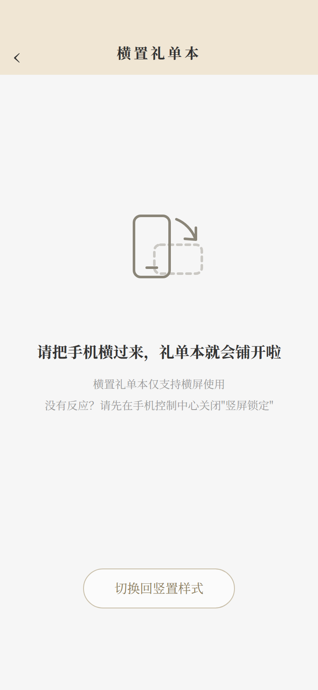

# 预览指南：把小程序在自己电脑上打开看

这份指南是给完全没用过微信开发者工具的人看的，照着一步步点就行。
看完你就能在电脑上打开咱们的礼单簿小程序，点一点、翻一翻，
还能把手机横过来看"横置礼单本"的效果。

先说清三件事：

1. 现在打开的是**演示版**：里面的账目、亲友都是假的演示数据，
   就是给你看样子用的，随便点、随便删，不影响以后正式版。
2. 演示版的数据存在自己电脑里，不上网、不花一分钱。
3. 不需要你改任何代码文件。哪一步卡住，把卡住的画面截图发回来就行。

---

## 第一步：从 GitHub 把代码下载下来

1. 用浏览器打开仓库页面：`github.com/liyaoguo7-dotcom/Lidanbu`
   （如果打开后让你登录，先登录你自己的 GitHub 账号；这个仓库是不公开的，
   不登录看不到。）
2. 在仓库页面上方，找到一个**绿色的按钮，写着「Code」**
   （在文件列表的右上方，绿色很显眼）。
3. 点「Code」，在弹出的小框里点最下面的 **「Download ZIP」**
   （ZIP 就是一个打包好的压缩文件）。
4. 下载完是一个叫 `Lidanbu-main.zip` 的文件，双击它解压
   （Windows 可以右键 →「全部解压缩」）。
5. 解压后会得到一个文件夹，名字一般是 `Lidanbu-main`，先放桌面上，好找。

## 第二步：把项目导入微信开发者工具

1. 打开**微信开发者工具**（没有的话先去微信公众平台官网下载安装，
   名字就叫"微信开发者工具"；打开后用微信扫码登录一次）。
2. 进去后会看到一个项目列表页。点右上角的**「导入」**两个字
   （如果你的版本没有"导入"，就点页面中间那个大大的**「＋」**号，意思一样）。
3. 在弹出的窗口里：
   - **目录**：点输入框右边的选择按钮，找到第一步解压出来的文件夹点进去。
     ⚠️ **这一步最容易错，仔细看**：要选的这一层文件夹，打开后应该能直接看到
     一个叫 `project.config.json` 的文件，和一个叫 `miniprogram` 的文件夹，
     两个在同一层。选到这一层就对了。
   - **AppID**：见第三步，不用填正式的。
   - 最后点窗口右下角的**「导入」**按钮。

**文件夹选错一层会怎么样、怎么改：**

- 如果打开后模拟器（右边那个手机框）提示"启动失败"，或者打开来是个空项目、
  左边一个文件都没有——十有八九是文件夹选错了一层。
- 改法：回到项目列表页，把这个项目从列表里移除（右键或悬停时有移除选项，
  只是从列表拿掉，不会删你电脑上的文件），重新点「导入」，
  这次在文件夹里**再往里进一层**（比如你上次选的是 `Lidanbu-main`，
  这次展开它，选里面的那一层），或者**退回上一层**，
  以"能直接看到 `project.config.json`"为准，重新导入即可。

## 第三步：AppID 那一栏怎么选（不用申请，先用游客模式）

导入时如果问你 AppID（小程序的身份证号，正式版才需要真的）：

- 目录选对后，AppID 那一栏会自动带出来一个 `touristappid`
  （这是占位用的假号，专门给本地预览用的），**保持不动就行**。
- 如果弹出让你选账号的框，选**「测试号」**；如果有「游客模式」字样的选项，
  也可以直接选它进去。
- 用游客模式/测试号，页面预览、点按、横屏，全都能看；
  只是用不了"云开发"（把数据存到腾讯服务器上的功能）和"上传发布"，
  这些等以后拿到正式 AppID 再开，现在**完全不用管**。

## 第四步：看预览——「编译」和「预览」有什么区别

项目打开后，窗口上方有一排按钮，先记住两个：

- **「编译」**（上方工具栏靠中间，图标是个刷新样的箭头，或者直接写"编译"）：
  点它，右边那个手机框（叫"模拟器"，就是在电脑里假装一部手机）就会刷新，
  把小程序跑给你看。**平时看效果就用它**，改完图、想再看都点它。
  大多数时候它自己就会自动刷新，不用手动点。
- **「预览」**（在"编译"右边不远，图标是个眼睛）：
  点它会生成一个二维码，用你手机微信扫一扫，小程序就在**真手机**上打开。
  想试横屏效果、或者觉得电脑里看着不放心时，用这个上手机看，最真实。

简单说：**「编译」是电脑里看，「预览」是手机上看。**

## 第五步：让模拟器横过来，看横置礼单本

横置礼单本是横着看的页面。在电脑的模拟器里这样转：

1. 看模拟器（右边手机框）的**最下面一排小按钮**：
   最左边显示着手机型号（比如 `iPhone 12/13 ...`），右边跟着几个小圆图标。
2. 其中有一个图标长得像**一个方框带一条弯箭头**（表示转屏），
   就是它，点一下，模拟器就从竖着变成横着；再点一下转回来。
3. 如果按钮太多不好认，也可以点模拟器右上角的设置里找"旋转"；
   实在找不到，就用「预览」上真手机看，把手机横过来最直观
   （记得先关掉手机的"竖屏锁定"，不然手机不肯横过来）。

竖着的时候，横置页面会显示一个"请横屏"的提示页，长这样：

横过来之后，就能看到铺开的礼单本了（这是传统经典样式）：

## 第六步：打开横置开关

横置礼单本是会员功能，开关在「我的」页面里：

1. 点小程序**最下面一排**的「我的」。
2. 往下找到一行字：**「经典红字大写横置礼簿模式」**，右边有个小开关，
   点一下把它打开（变红就是开了）。
   - 如果点了它却弹出"会员专属功能"的框，说明你现在是"免费"身份，
     先做第七步把身份切成"会员"，再回来开这个开关。
3. 开关打开后，回到「收礼」页面，点任意一个礼薄，
   打开的就是横置礼单本（模拟器记得先转成横屏，或者用手机横着看）。
4. 在横置页面里点任意一列，能看到这条记录的详情；
   右上角有"样式"入口，可以换字体（三种）和样式（六种），随便换着看，
   换字体不会把样式弄丢，换样式也不会把字体弄丢。
5. 看够了想回竖着的样子：在横置页面里点**「切换回竖置样式」**按钮，
   或者回「我的」把开关关掉。

送礼也有横置版：到「送礼」页面，顶部有一行「横置礼单本」，点它进去。

## 第七步：切换"我是会员还是免费"（演示专用）

演示版里专门留了一个切换身份的入口，正式版没有这一行：

1. 点最下面一排的「我的」，往下翻（在横置开关那一块的下面），
   找到一行：**「演示：切换会员状态」**，右边写着你现在的身份
   （免费 / 会员 / 会员已到期（缓冲期））。
2. 点这一行，会从下面弹出三个选项：**免费、会员、会员已到期（缓冲期）**，
   选一个，身份立刻就变了。
3. 变了之后可以对比着看：
   - **免费**：礼薄最多 3 个、横置开关点不开（会弹会员介绍）。
   - **会员**：额度变大、横置能开、家庭共享能邀请。
   - **会员已到期（缓冲期）**：刚过期的状态，能看不能新增太多，
     用来模拟"会员到期了"是什么样。

## 第八步：演示数据长什么样

第一次打开，里面已经预先放好了一套假数据（都是编的，不是真人的）：

- **亲友 12 位**：张三、李四、王五、赵六、刘七、陈八、孙九、周十、
  吴小明、郑文杰、欧阳修远、欧阳。
- **收礼礼薄 3 个**：「张三的婚礼」（里面 12 条记录）、
  「赵六的乔迁宴」（5 条）、「王老太爷丧礼」（白事，4 条）。
- **送礼记录 8 条**：其中一条是给王五的白事奠仪。
- 金额都是整百整千的整数，日子分布在最近一年里，
  所以「往来」页面打开就能看到汇总和每条往来的明细。

这些数据随便删、随便改，删光了也不怕——把微信开发者工具里这个项目
移除再重新导入一次，演示数据会重新生成一份新的
（数据是第一次打开时种下的，种完有标记，重复打开不会叠加）。

---

## 常见问题

**1. 模拟器启动失败，手机框里写着"模拟器启动失败"。**
多半是第二步文件夹选错了一层。按第二步末尾的改法，移除项目重新导入，
选到能直接看见 `project.config.json` 的那一层。如果层选对了还失败：
把开发者工具整个关掉重开，再点一次上方工具栏的「编译」。

**2. 打开是空文件夹，左边文件列表什么都没有。**
同上，文件夹选错层了（选到了外壳文件夹）。重新导入，
往里进一层或者退一层，以看到 `project.config.json` 为准。

**3. 页面一片空白，或者一直转圈。**
先等十几秒（第一次编译慢一点）；还不行点一下上方工具栏的「编译」按钮刷新；
再不行检查工具上方是不是停在"普通编译"（是的话就对了），
然后把工具关掉重开、重新导入项目。

**4. 找不到"云开发"按钮。**
正常，现在不用管它。你现在用的是游客模式（第三步），
游客模式下本来就没有云开发这个功能。云开发是以后拿到正式 AppID、
要把数据存到网上时才开的东西，这次预览本地演示版完全用不到。

**5. 横置开关点不开，老弹"会员专属功能"。**
因为你现在是"免费"身份。先按第七步把身份切成"会员"，再回来点开关。

**6. 手机横过来，页面不跟着转。**
手机开着"竖屏锁定"（有的手机叫"锁定屏幕方向"）。
从手机屏幕顶部往下拉出快捷设置，把那个锁样的图标关掉，再横过来试。

**7. 数据和我上次看的不一样 / 没了。**
演示数据存在开发者工具自己的存储里，清掉工具缓存、换电脑，
都会重新种一份，这是正常的，不影响你看功能。

---

*最后提醒一句：这份指南说的是"在电脑上看演示版"。
正式上线要填的两样东西（云环境 ID 和小程序 AppID）拿到之后，
填的位置在代码里已经留好了，到时候按《云环境切换步骤.md》走，不用再改别的。*

> 补充（老板平台预览）：演示模式不用手动加名单了——每次启动时，演示账号会**自动**被加进管理员名单（appConfig 的 adminIds），本地预览直接就能打开老板平台。正式环境仍然是没在名单里的人谁都进不去，名单只由后台维护。
> 老板平台入口藏在「我的」页：翻到最底部，**连点版本号 5 次**，就会进入老板平台。

## 支付与老板平台联动自测（5 步）

想验证"买会员 → 订单 → 后台看到 → 改价生效"这条链路通不通，照下面走一遍（全程模拟支付，不花真钱）：

1. 进「会员与积分」购买页，点年卡走模拟支付，选**支付成功**。
2. 回到购买页下方的「我的订单」，确认能看到这笔：年卡、70 元、状态"已开通"。
3. 进老板平台（「我的」页底部连点版本号 5 次），打开「会员订单与收入」，确认能看到刚才那笔订单：用户是脱敏编号、档位年卡、金额 70 元、状态已支付。
4. 还在老板平台里，进「额度与会员价格设置」，把年卡价格改成 66 元，保存（会弹二次确认，改动会记进操作记录）。
5. 回到购买页刷新，年卡价格应已变成 66 元——说明配置是同一个数据源、改完即时生效。

> 如实注记：支付**失败、取消、重复回调**这三条路线，在开发者工具里点不出来（模拟支付只有一个成功入口）。这三条路由自动化测试覆盖（`tests/test-payment.js`、`tests/test-points-pack.js`，含重复回调只入账一次、失败/取消不发货的断言），本地全套测试通过即代表代码路径正常。
